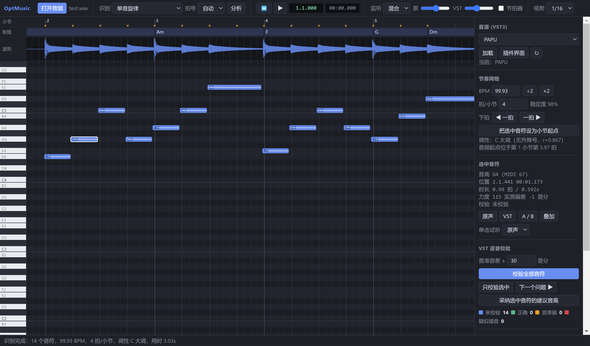

# OptMusic 音乐工作台

第一版：类似 Melodyne 的「音频 → MIDI」工作台。

- 把 WAV（也支持 FLAC / MP3 / OGG）识别成 MIDI 音符，在钢琴窗中显示音符、实测音高曲线和音准偏差；
- 自动识别 **BPM、拍号、下拍、小节**，以及 **调性 / 调号** 和 **和弦**；
- 调用本机 **VST3 音源** 逐音试听（原声 / VST / A-B / 叠加）并自动校验每个音是否正确（八度错、半音错、音准偏）；
- 可编辑音符（移动、改长度、增删、量化、撤销），导出标准 MIDI 文件。

算法原理见 **[docs/算法原理.md](docs/算法原理.md)**；人声转写如何降低手工修改量见 **[docs/编辑量优化.md](docs/编辑量优化.md)**。

## 桌面版（推荐）

桌面版 = **Electron 外壳（TypeScript，`desktop/`）+ Python 后端（音频分析 + VST 宿主）**。
双击 `OptMusic.exe` 即可使用，无需安装 Python：



- 启动时先显示“启动中”页面，后端就绪（约 5~15 秒）后进入主界面；
- 第一次分析需要编译加速代码（约 1 分钟，启动后会在后台预热），之后每次只需几秒；
- 关闭窗口时后端进程会一起退出；日志在 菜单「文件 → 打开日志目录」。

### 打包桌面版

前置：已按下文创建 Python 虚拟环境，并安装 Node.js。

```bash
cd desktop
npm install
npm run dist
```

产物：`desktop/release/win-unpacked/OptMusic.exe`（整个 `win-unpacked` 文件夹约 550 MB，可直接压缩发给别人）。
需要安装包时用 `npm run dist:installer`（NSIS）。

构建步骤：`tsc` 编译外壳 → PyInstaller 按 `packaging/optmusic-backend.spec` 把后端打成 `optmusic-backend.exe` → electron-builder 把它放进 `resources/backend/`。

网络较慢时可用国内镜像：

```bash
set ELECTRON_MIRROR=https://npmmirror.com/mirrors/electron/
set ELECTRON_BUILDER_BINARIES_MIRROR=https://npmmirror.com/mirrors/electron-builder-binaries/
```

开发调试桌面外壳（使用仓库里的 `.venv` 运行后端）：

```bash
cd desktop
npm start
```

## 从源码运行（浏览器版）

需要 Python 3.12（推荐用 [uv](https://docs.astral.sh/uv/)）：

```bash
uv venv --python 3.12 .venv
uv pip install --python .venv\Scripts\python.exe -r requirements.txt
uv pip install --python .venv\Scripts\python.exe --no-deps basic-pitch==0.4.0
```

启动并用浏览器打开：

```bash
.venv\Scripts\python.exe run.py --open
```

或双击 `start.bat`。

算法自测（人声评测需先下载 vocadito 到 workspace/datasets/vocadito，见 `tests/vocal_bench.py`）：

```bash
.venv\Scripts\python.exe -m tests.test_pipeline
```

## 使用流程

1. **打开音频** → 自动识别（根据多音比例自动选择单旋律或复音引擎；也可在“识别”里手动指定）。
2. 检查 **节奏网格**：标尺上的橙色三角是检测到的原始拍点，可打开 **节拍器** 播放核对；速度不对用 `÷2 / ×2`，小节线不对用 `◀ 一拍 / 一拍 ▶` 或“把选中音符设为小节起点”。
3. 右侧 **音源** 选择 VST3 插件 → 加载（可打开插件界面选音色，关闭窗口后生效）。
4. **单击音符**即用当前音源弹出它的音高（加载音源 / 分析完成后会在后台预载所有用到的音高，之后单击即时发声；预载完成前先用内置预览音）。可在“单击试听”里改成原声片段、叠加或关闭。
5. **校验全部音符**：绿 = 正确，橙 = 音准偏，红 = 疑似错音（可“采纳建议音高”）；用“下一个问题”逐个检查，`1/2/3/4` 键试听原声 / VST / A-B / 叠加。
6. 编辑后 **导出 MIDI**（按小节对齐，或按音频起点对齐）。

### 快捷键

| 操作 | 按键 |
|---|---|
| 播放 / 停止 | 空格 |
| 删除 | Delete |
| 移半音 / 八度 | ↑ ↓ / Shift + ↑ ↓ |
| 按吸附移动 | ← → |
| 量化 | Q |
| 撤销 / 重做 | Ctrl+Z / Ctrl+Y |
| 全选 | Ctrl+A |
| 横向缩放 / 纵向缩放 | Ctrl+滚轮 / Ctrl+Shift+滚轮（Alt+滚轮同样可纵向缩放） |
| 上下滚动 / 左右滚动 | 滚轮 / Shift+滚轮 |
| 拖动时不吸附 | 按住 Alt |

## 结构

```
run.py                 后端入口（Web 服务在后台线程，VST 宿主占用主线程；就绪后打印 OPTMUSIC_READY <port>）
desktop/               Electron 桌面外壳（TypeScript）：窗口、启动后端、另存为对话框、打包配置
packaging/             PyInstaller 后端打包配置
optmusic/analysis.py   音高追踪、音符切分、BPM/下拍/拍号、频谱轮廓
optmusic/harmony.py    调性 / 调号、和弦识别
optmusic/host.py       VST3 扫描、加载、渲染（pedalboard），内置兜底合成器
optmusic/midi_export.py MIDI 导出
optmusic/server.py     HTTP API（FastAPI）
web/                   前端（钢琴窗、播放、校验界面）
docs/算法原理.md        算法原理文档
tests/                 合成音频端到端自测
```

## 已知限制（v0.1）

- 识别引擎自动选择：人声分轨 / 独奏用“单旋律”（复音模型主干 + pYIN 补漏 + 沿音高延伸；vocadito 40 段独唱上：在唱帧覆盖 95.1%、音符 F1 0.662，两位人工标注者之间为 0.740），和弦 / 钢琴 / 伴奏用复音模型 basic-pitch（ONNX）。复音模式对弦乐等缓慢起音乐器召回偏低，详见算法文档 1.5–1.6。
- 恒定速度假设，变速歌曲网格会逐渐偏离。
- 只支持 VST3（pedalboard 不支持 VST2）。本机实测：Surge XT、PAPU、BBC Symphony Orchestra 直接用 VST3 渲染；Pianoteq 的 VST3 离线无声，程序会自动改用 Pianoteq 独立程序的命令行渲染（可选预设）。
- 桌面版未做代码签名，首次运行时 Windows SmartScreen 可能提示“未知发布者”，选择“仍要运行”即可。
